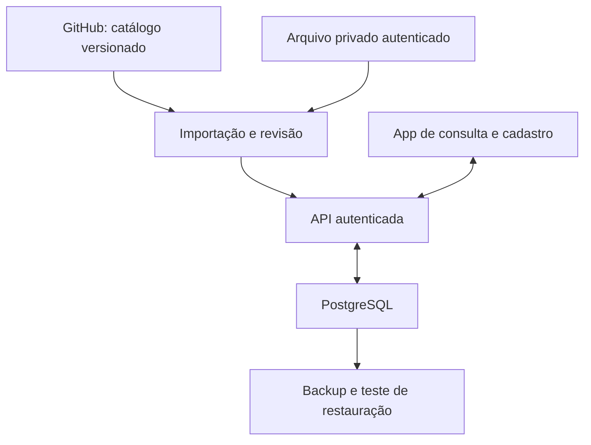
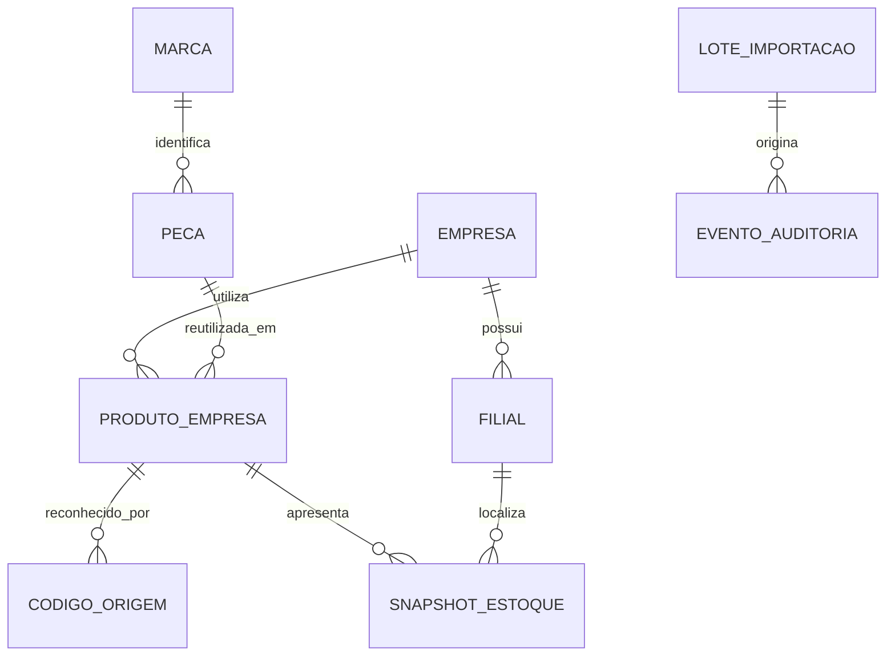
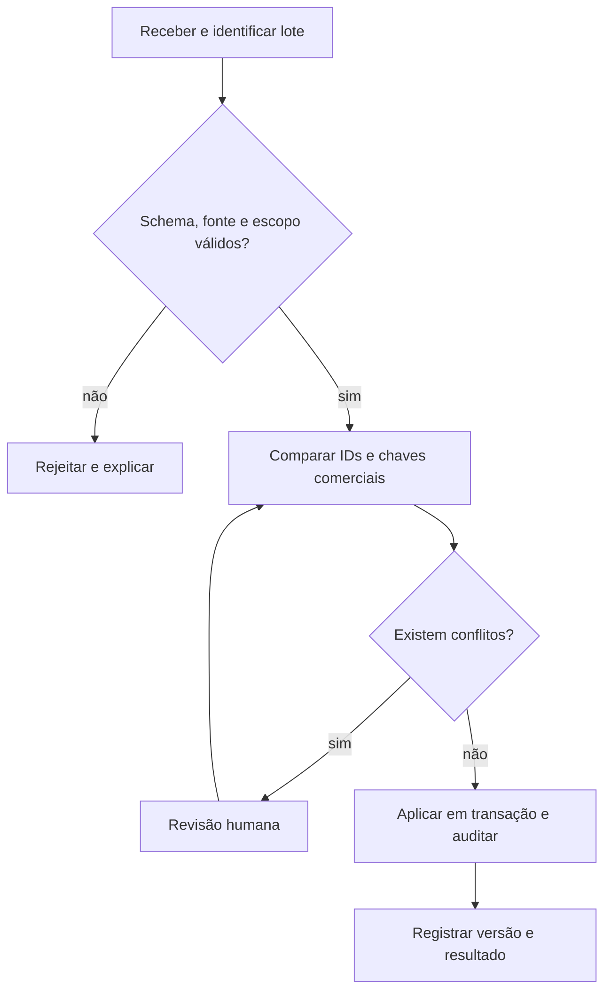

# Arquitetura de dados e operação

Data de corte da pesquisa: 18/10/2026. Esta é uma proposta de implementação; o arquivo HTML é uma prévia local. Não há API, banco remoto ou credenciais configuradas.

## Decisão

Usar PostgreSQL como banco de operação e uma API autenticada como único caminho de leitura e gravação do app. Manter no GitHub o código, schemas, migrações e catálogos de demonstração. Arquivos reais privados entram por upload autenticado ou por integração de servidor com repositório privado expressamente configurado.

Essa escolha é uma decisão de arquitetura para cadastros relacionados e múltiplos usuários. As documentações oficiais confirmam os mecanismos usados na proposta; não demonstram que uma tecnologia seja universalmente a melhor.

## Identidade e separação

| Registro | Chave estável e regras | Pertence a |
|---|---|---|
| Marca | UUID interno; aliases precisam de revisão, não são fusão automática | Catálogo técnico autorizado |
| Peça | UUID interno; fabricante/marca + código original + variante quando necessária | Catálogo técnico autorizado |
| Referência OEM | Montadora + código original, com fonte e validade | Cadastro técnico |
| Aplicação | Peça + configuração determinante + evidência | Cadastro técnico |
| Empresa | UUID estável; estabelecimento principal informado, sem inferência por nome | Espaço de trabalho autorizado |
| Filial/estabelecimento | UUID, empresa, CNPJ quando disponível e papel matriz/filial explícito | Empresa |
| Produto da empresa | Empresa + peça mestre; aliases comerciais separados por namespace | Empresa |
| Código de origem | Empresa + sistema de origem + código interno | Empresa |
| Snapshot de estoque | Empresa + filial + produto da empresa + instante + fonte | Empresa |
| Lote de importação | Fonte + versão/hash + escopo/empresa + versão do mapeamento | Escopo autorizado |
| Evento de auditoria | UUID, autor, instante, entidade, valores anterior/posterior, lote | Escopo autorizado |

O diagrama é conceitual. UUID identifica a entidade e não muda ao corrigir descrição. O código do fabricante é texto, preservando zeros, pontuação e sufixos. O mesmo código em duas marcas não prova que sejam similares. Um código apenas parecido não gera vínculo nem fusão.

O `UNIQUE` deve representar a regra comercial confirmada. Se um fabricante reutilizar código entre variantes, a variante faz parte da identidade. Na prévia, marca + código (sem diferenciar maiúsculas e minúsculas) é a regra simplificada explicitamente adotada. A representação original continua salva. Uma colisão bloqueia o lote para revisão.

No banco real, chaves estrangeiras compostas incluindo `empresa_id` devem impedir que o snapshot de uma filial use o vínculo de outra empresa. Restrições `UNIQUE`, `NOT NULL` e chaves estrangeiras sustentam a integridade; a aplicação não deve depender somente de uma busca antes do `INSERT`.

## Compartilhar conhecimento técnico

A base reaproveitável contém descrição, marca, código, atributos, referências, fontes e evidências autorizadas. Preços, custos, movimentos, vendas, reservas e saldos ficam no escopo da empresa. Catálogos privados de clientes não se tornam globais automaticamente.

O utilizador precisa de permissão sobre a empresa e sobre o catálogo consultado. A API resolve a identidade pelo login, verifica o acesso e associa o escopo à transação. Nunca confiar apenas no `empresa_id` enviado pelo navegador.

Row-Level Security pode ser uma camada adicional no PostgreSQL. O papel de aplicação não pode ser superusuário, proprietário das tabelas ou possuir `BYPASSRLS`; aplicar políticas com `USING` e `WITH CHECK` e testar leitura, alteração e criação entre empresas. Uma variável de sessão isolada não substitui autenticação. O seletor de empresa da prévia é apenas navegação demonstrativa.

## Importação sem perda silenciosa

1. Registrar origem, commit ou hash, instante de extração, empresa, mapeamento e versão do schema. Conservar o original em armazenamento privado com política de retenção.
2. Validar schema, chaves, unidades, referências entre entidades e duplicidades internas. Ausência de linha não significa saldo zero.
3. Tratar reenvio do mesmo lote de forma idempotente. Um índice no identificador do lote impede aplicação dupla. O lote pode registrar que nada mudou.
4. Se a identidade coincide e os campos são iguais, reconhecer o registro já existente. Se há diferença, registrar o conflito, origem e revisão; não escolher automaticamente um vencedor.
5. Aplicar o lote aprovado em uma transação. Atualização concorrente usa versão esperada/`If-Match`; divergência responde conflito, sem último escritor silencioso.
6. Registrar autor e alterações. Correções e desativações mantêm histórico; fusão, se aprovada, mantém redirecionamento do identificador antigo e trilha da decisão.

Na prévia, o importador verifica identidade e conteúdo de marca/peça, bloqueia o lote inteiro em conflito e acrescenta apenas registros novos. Ele não atualiza cadastros técnicos existentes nem importa vendas, custos ou estoque do GitHub.

## API proposta

| Operação | Rota ilustrativa | Regra |
|---|---|---|
| Consultar catálogo | `GET /v1/pecas?q=&marca_id=&cursor=` | Autorização do catálogo e paginação |
| Cadastrar peça | `POST /v1/pecas` | Chave comercial validada; duplicidade retorna conflito |
| Consultar empresas | `GET /v1/empresas` | Apenas empresas permitidas ao utilizador |
| Reaproveitar peça | `POST /v1/empresas/{id}/produtos` | Criar vínculo, mantendo a mesma peça mestre |
| Identificar código interno | `POST /v1/empresas/{id}/codigos-origem` | Namespace explícito; sem fusão por código isolado |
| Consultar estoque | `GET /v1/empresas/{id}/estoques?filial_id=` | Snapshot mais recente por fonte reconciliada, com data |
| Preparar lote | `POST /v1/importacoes` | Upload privado, validação e prévia das diferenças |
| Aplicar lote | `POST /v1/importacoes/{id}/aplicar` | Permissão, versão esperada e idempotência |
| Consultar histórico | `GET /v1/auditoria?entidade_id=` | Mesmo escopo de autorização da entidade |

As rotas são um contrato proposto; não estão expostas pelo HTML. Antes de produção, implementar validação completa de esquema, limites, paginação, testes de permissão e transações.

## CNPJ em outubro de 2026

Armazenar como texto de 14 posições após normalização apenas da máscara, com letras A–Z e números nas primeiras 12 posições e verificadores numéricos nas duas finais. Preservar zeros à esquerda e validar os dígitos pelo método oficial. CNPJs numéricos continuam válidos. Não concluir matriz/filial pelo sufixo `0001` nem pelo nome de arquivo.

O formulário da prévia verifica formato e dígitos do valor informado. Ele não consulta a Receita Federal e não comprova existência ou situação cadastral. CNPJ é opcional somente para exemplos locais; os requisitos de produção dependem do tipo de entidade.

## Fontes oficiais consultadas

- [PostgreSQL — constraints](https://www.postgresql.org/docs/current/ddl-constraints.html): unicidade composta, chaves primárias e referências.
- [PostgreSQL — Row Security Policies](https://www.postgresql.org/docs/current/ddl-rowsecurity.html): políticas e exceções de proprietário, superusuário e `BYPASSRLS`.
- [PostgreSQL — backup e restauração](https://www.postgresql.org/docs/current/backup.html): estratégias de cópia e recuperação.
- [GitHub — conteúdo de repositório](https://docs.github.com/en/rest/repos/contents): leitura por `ref`, acesso público e conflitos nas operações de escrita.
- [GitHub — boas práticas da API](https://docs.github.com/en/rest/using-the-rest-api/best-practices-for-using-the-rest-api): limites e tratamento das solicitações.
- [Receita Federal — CNPJ alfanumérico, perguntas e respostas](https://www.gov.br/receitafederal/pt-br/centrais-de-conteudo/publicacoes/perguntas-e-respostas/cnpj/cnpj-alfanumerico.pdf/@@download/file): composição, coexistência dos formatos, verificadores e matriz/filial.
- [Figma — Plugin Manifest](https://developers.figma.com/docs/plugins/manifest/): formato do importador de desenvolvimento.

Esses fundamentos são anteriores ou aplicáveis à data de corte. Não há alegação de novidade de setembro/outubro nem de ganho garantido por um estudo não validado.
